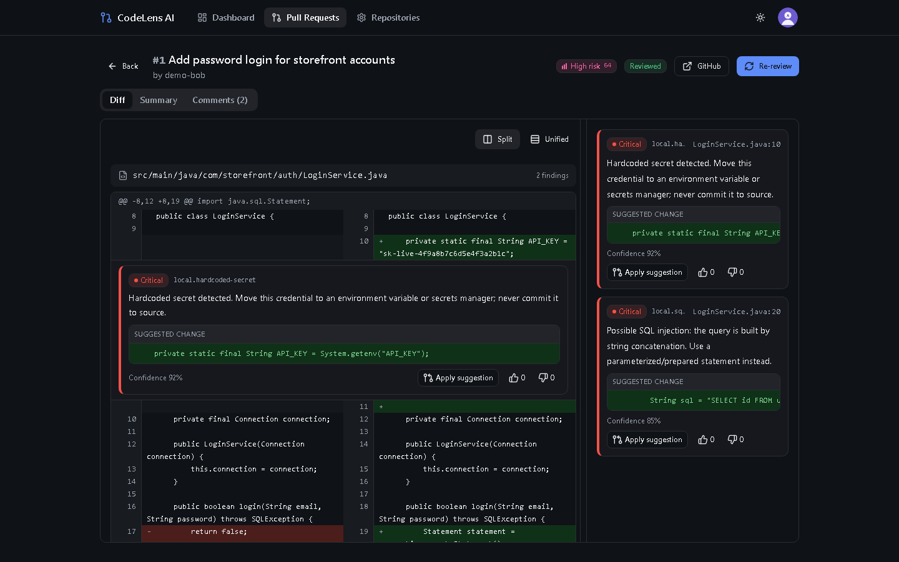
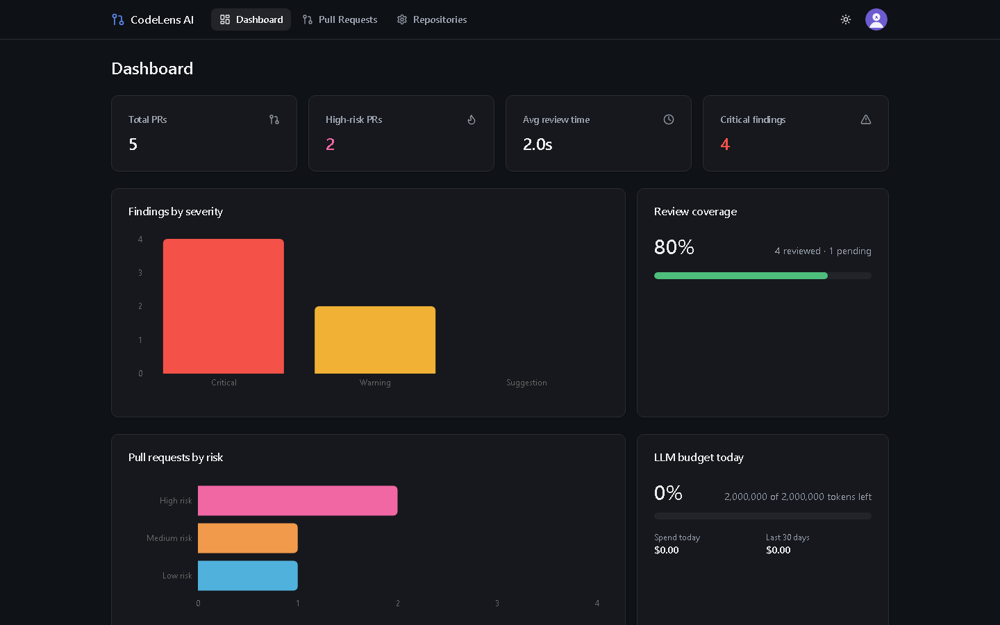
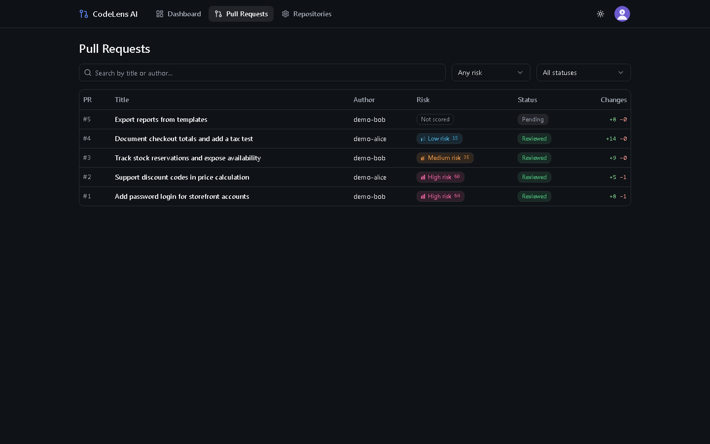
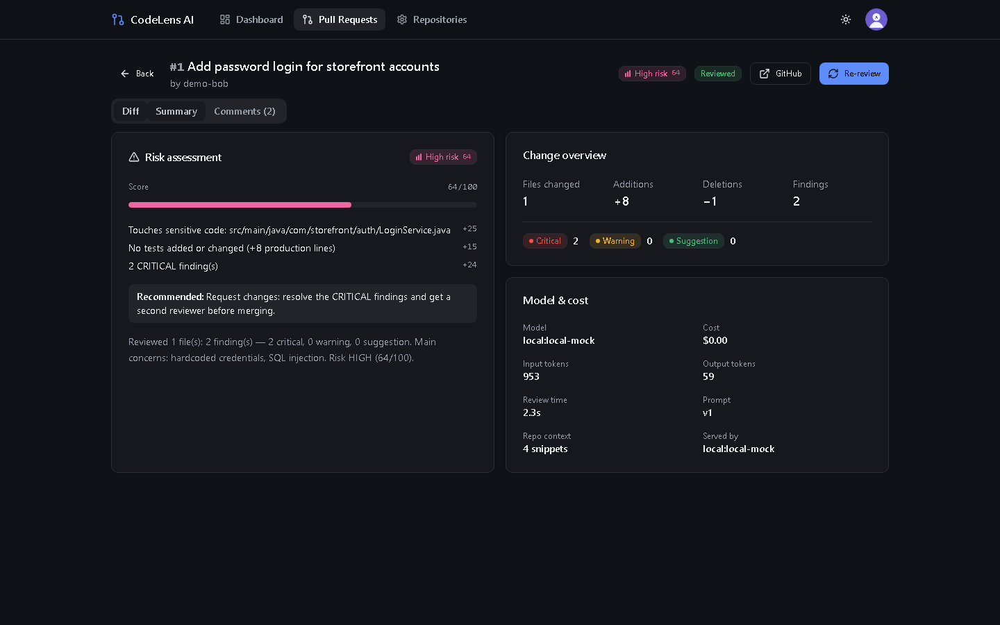
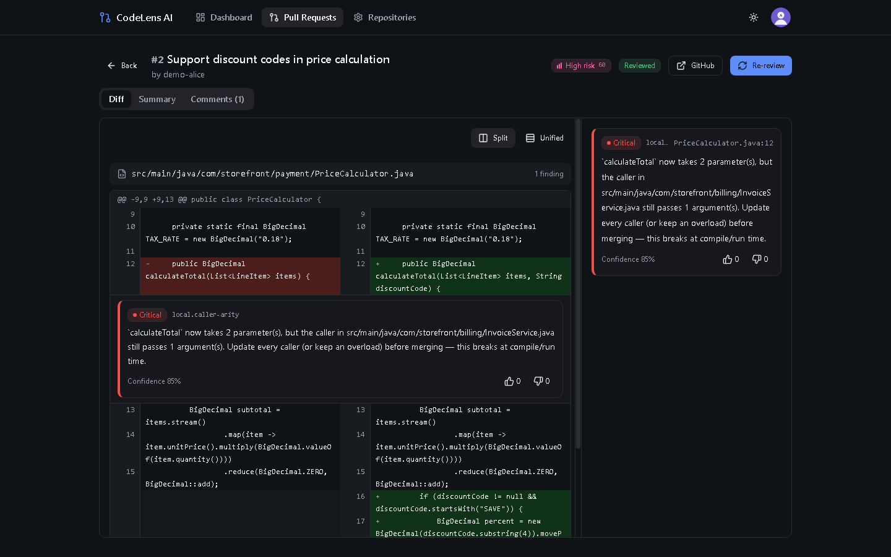
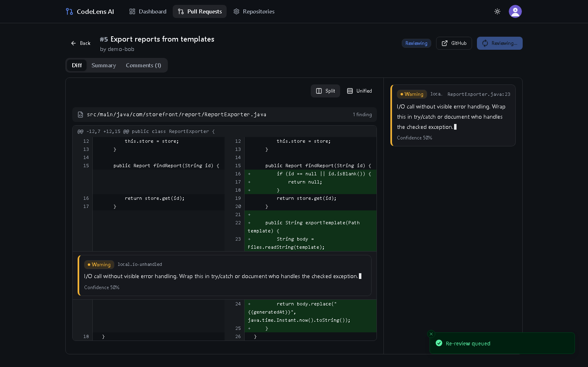
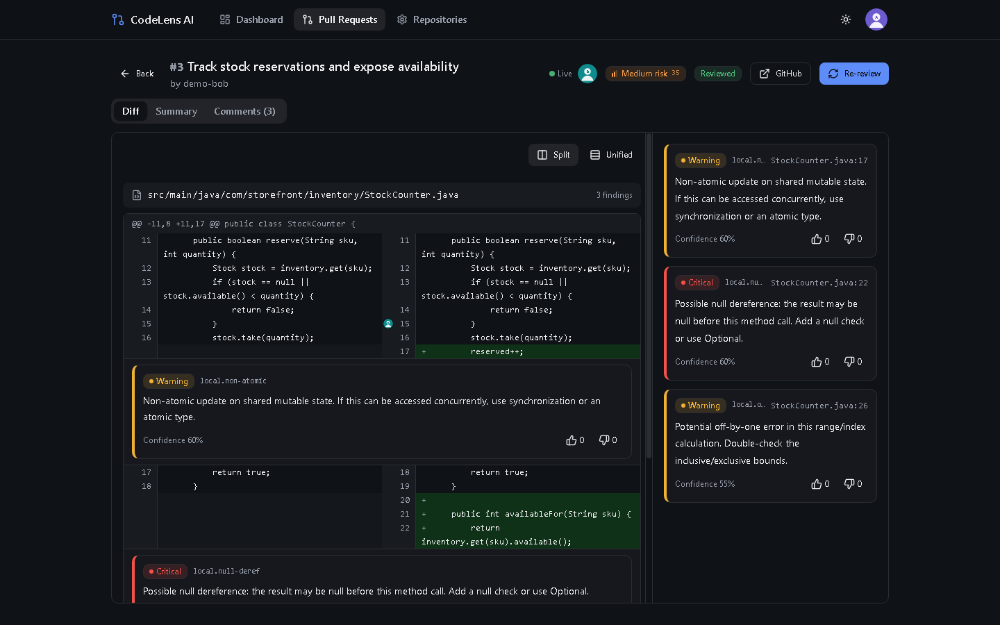
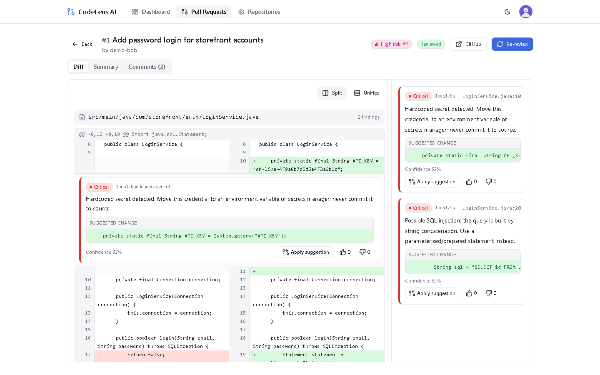
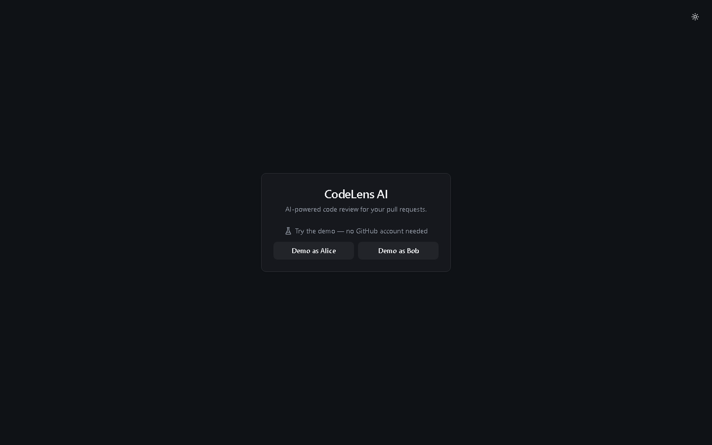
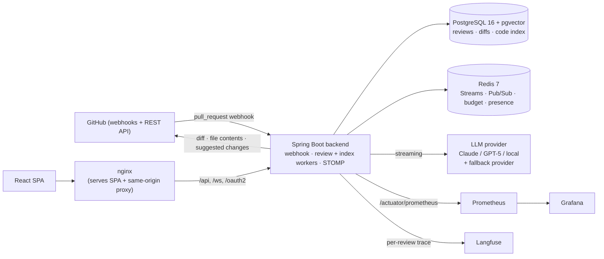

# CodeLens AI — Real-time AI Code Review Platform

> Every GitHub PR gets an AI review in under 30 seconds. Reviewers watch findings stream in over
> WebSocket, inline on the exact diff line — with the PR's risk, the review's cost, and the code
> *around* the diff (callers, tests) taken into account.

CodeLens AI ingests GitHub PR webhooks idempotently, queues diff analysis through Redis Streams, runs a
frontier model (Claude, GPT-5, or an offline mock) behind a provider-agnostic adapter with retries, a
cross-vendor fallback and a daily token budget, and relays structured findings to every connected browser
over STOMP (fanned out across pods via Redis Pub/Sub). Each review retrieves related code from a pgvector
index of the repository, scores the PR's risk, and learns from reviewers' thumbs-down.



## Features

**Review**
- AI auto-reviews every new PR; findings (CRITICAL / WARNING / SUGGESTION) stream in live and are
  persisted in PostgreSQL. Re-review on demand.
- **Repository-aware context (G1)** — callers, tests and similar code from a pgvector index of the default
  branch, so the reviewer catches *"you changed `calculateTotal`'s signature but `InvoiceService` still
  passes one argument"*.
- **Structure-aware chunking (G4)** — JavaParser for Java, brace/indent parsers for JS/TS/Go/C#/Kotlin/
  Rust/Python: a function is never split across two LLM calls.
- **Inline diff** — split or unified, every finding rendered directly under its line, with the model's
  suggested change.

**Triage**
- **Explainable PR risk score (G3)** — HIGH / MEDIUM / LOW from deterministic factors (sensitive paths,
  missing tests, size, caller fan-in, findings), each with its reason; a written summary; a risk filter on
  the PR list and a risk chart on the dashboard.
- **Cost per review** — model, input/output tokens and USD for every review; a daily token budget enforced
  atomically in Redis; spend and budget on the dashboard.

**Collaborate & learn**
- **Apply suggestion (G6)** — posts the fix to the PR as a GitHub *suggested change* (idempotent; refuses
  when the PR moved on).
- **Feedback flywheel (G7)** — thumbs up/down per finding; votes survive re-reviews; rules a team keeps
  dismissing are suppressed for that repository; dismissals export as negative eval cases.
- **Live presence (G5)** — see who else is viewing a PR and which line each person is pointing at.
- **Resumable stream** — reconnecting browsers replay what they missed from a Redis buffer, without
  duplicates.

**Platform**
- GitHub OAuth2 login (sessions), membership-based access checks on REST *and* WebSocket.
- Providers: **Claude** (official Anthropic Java SDK, `claude-opus-5-5`), OpenAI GPT-5, offline `local`;
  Resilience4j retry / circuit breaker / bulkhead with a cross-vendor fallback provider.
- Idempotent webhook handling + effectively-once review processing (Redis Streams + DLQ).
- Review-quality **eval gate** in CI: precision/recall, cross-file recall (with vs without repository
  context), risk accuracy and a **cost-regression gate**.
- **Demo mode**: a seeded repository and five PRs, password-less demo login — no GitHub app or API key.
- Prometheus + Grafana dashboards, Langfuse tracing, Docker Compose, GitHub Actions with Playwright E2E.

## Screenshots

| | |
|---|---|
|  Dashboard: risk distribution, LLM budget and spend |  PR list with risk bands and filters |
|  Explainable risk score and review cost |  A cross-file finding only repository context can catch |
|  Findings streaming in during a re-review |  Live presence: another reviewer and the line they are on |
|  Light theme |  Demo login |

Screenshots are generated by the Playwright suite (`npm run e2e:screenshots`).

## Tech stack

Spring Boot 4.1 (Java 21, Maven) · React 18 + TypeScript (Vite 7, TanStack Query, Zustand, Zod,
Tailwind 4, shadcn/ui) · PostgreSQL 16 + pgvector · Redis 7 (Streams, Pub/Sub, Lua) · STOMP/SockJS ·
Anthropic Java SDK / OpenAI · JavaParser · Resilience4j · Micrometer + Prometheus + Grafana · Langfuse ·
Testcontainers · Vitest · Playwright · Docker Compose · GitHub Actions.

## Architecture



### Request flow (webhook → real-time review)

1. GitHub fires a `pull_request` webhook → `POST /api/webhooks/github`; the HMAC signature is checked
   against the repository's own secret (then the global one), and duplicates are dropped on
   `X-GitHub-Delivery`.
2. A review job goes onto the Redis Stream `review-jobs`; the request returns `202`.
3. The consumer snapshots the diff (`pr_diffs`), chunks it along code structure, and for each chunk
   retrieves related code (callers, tests, neighbours) from the pgvector index.
4. Chunks are reviewed concurrently on virtual threads; each finding is pushed to `/topic/pr/{id}/review`
   the moment the model closes it (and buffered in Redis for clients that reconnect).
5. On completion: findings, tokens, cost and the risk score persist (idempotent on `(pr_id, head_sha)`),
   feedback from the previous run is re-linked, and a summary comment with the risk posts to the PR.

## Quick start: the demo (no GitHub app, no API key)

The `demo` profile seeds Alice and Bob, the repository `codelens-demo/storefront` and five PRs: a committed
secret + SQL injection (HIGH), a signature change that breaks a caller elsewhere in the repo (HIGH,
cross-file), a race condition (MEDIUM), a tests-only change (LOW), and one pending PR to re-review live.

```bash
# infrastructure: Docker…
cd codelensai && docker compose -f compose.yaml up -d && cd ..
# …or WSL Ubuntu without Docker (Postgres 5433 + pgvector, Redis): bash scripts/wsl-infra-setup.sh

# backend with the demo profile (Windows PowerShell; uses the WSL ports — see build-and-run.md)
./scripts/run-demo-backend.ps1
# or anywhere:  SPRING_PROFILES_ACTIVE=demo ./mvnw spring-boot:run   (in codelensai/)

# frontend
cd frontend && npm install && npm run dev      # http://localhost:5173 → "Demo as Alice"
```

Open a second browser profile as Bob on the same PR to see presence. The demo login is loopback-only and
the backend refuses to start the demo profile next to `prod` or a real GitHub OAuth app
([ADR 0006](docs/adr/0006-demo-profile-and-websocket-auth.md)).

## Quick start (Docker, real GitHub)

```bash
git clone <your-fork-url> codelensai && cd codelensai
cp .env.example .env       # GitHub OAuth app; optionally ANTHROPIC_API_KEY (LLM_PROVIDER=claude) or OpenAI
docker compose up -d --build
```

| Service    | URL                          | Notes                                   |
|------------|------------------------------|-----------------------------------------|
| Frontend   | http://localhost:3000        | SPA + same-origin `/api`, `/ws` proxy   |
| Backend    | http://localhost:8080        | REST + actuator + WebSocket             |
| Prometheus | http://localhost:9090        | scrapes the backend                     |
| Grafana    | http://localhost:3001        | login `admin` / `GRAFANA_ADMIN_PASSWORD`; "CodeLens AI — Overview" dashboard |
| Langfuse   | http://localhost:3002        | LLM tracing (off until you add keys)    |

LLM providers: `LLM_PROVIDER=local` (default, offline), `claude` (+ `ANTHROPIC_API_KEY`; model
`claude-opus-5-5`, `CLAUDE_SUMMARY_MODEL=claude-haiku-5-5` for cheaper summaries), or `gpt5`
(+ `OPENAI_API_KEY` and a real `REVIEW_MODEL`). `LLM_FALLBACK_PROVIDER` serves reviews when the primary is
down; `LLM_DAILY_TOKEN_BUDGET` caps spend. Embeddings default to an offline hashing embedder
(`CODELENS_EMBEDDING_PROVIDER=openai` for `text-embedding-3-small`).

GitHub OAuth callback URL: `http://localhost:3000/login/oauth2/code/github` (Vite dev:
`http://localhost:5173/login/oauth2/code/github`).

Full local setup, including WSL and environment variables: [build-and-run.md](build-and-run.md).

## Testing

```bash
cd codelensai && ./mvnw verify          # unit + Testcontainers integration tests (pgvector, Redis)
cd frontend && npm run lint && npm run test && npm run build
cd frontend && npm run e2e              # Playwright, against a running demo-profile backend
python -m pytest eval/test_scoring.py   # eval harness unit tests
```

Integration tests need Docker (Testcontainers). Without Docker they abort locally; CI sets
`CODELENS_REQUIRE_DOCKER=true` so they can never be skipped there. To run them against existing infra
(e.g. WSL) set `CODELENS_IT_EXTERNAL_INFRA=true` and the datasource/Redis env vars.

## Review-quality eval gate

`eval/` scores the reviewer on 31 diffs with planted bugs, clean controls and six cross-file cases that
ship repository context (`build_testset.py` is the readable source of `testset.jsonl`):

```bash
# backend running with CODELENS_INTERNAL_ENABLED=true (the demo profile enables it)
python eval/run_eval.py                              # report
python eval/run_eval.py --ci --ablate-retrieval      # CI gate
python eval/run_eval.py --save-baseline              # deliberate re-baseline
```

The gate enforces precision/recall ≥ 0.8, cross-file recall ≥ 0.8 **and** better than without repository
context, risk accuracy ≥ 0.8, no `must_not_flag` regressions, and fails if mean tokens per review grow
more than 20% over `baseline.json`.

## Monitoring

- Prometheus scrapes `backend:8080/actuator/prometheus`.
- Grafana's "CodeLens AI — Overview": review latency, queue depth, 5xx rate, LLM spend, token budget left,
  fallbacks/refusals/shed chunks, token mix, risk bands, retrieval latency, indexing, feedback and applied
  suggestions, live viewers and stream replays.
- Langfuse traces each review (model, prompt version, tokens, latency) when enabled.

## CI/CD

`.github/workflows/ci.yml`:

- `test-backend` — Maven `verify` with Testcontainers (Docker required, never skipped).
- `test-frontend` — lint, Vitest, build.
- `skills-consistency` — keeps the Claude skills in `.claude/skills/` in sync with the code: no retired guidance,
  identical `build-and-run.md` copies, every controller endpoint documented, valid evals
  (`scripts/check_skill_consistency.py`).
- `review-quality-eval` — boots the backend (local provider, pgvector) and runs the eval + cost gate with
  the retrieval ablation.
- `e2e` — boots the backend in the demo profile and runs the Playwright suite (report, traces and the
  backend log are uploaded on failure).
- `build-and-push` / `deploy` *(opt-in)* — images to DockerHub on `main`, SSH deploy.

The deploy jobs stay inert until you opt in. Set these repository **Actions variables** and **secrets**:

| Kind     | Name                  | Used for                                |
|----------|-----------------------|-----------------------------------------|
| Variable | `ENABLE_DOCKER_PUSH`  | `true` to enable image build-and-push   |
| Variable | `ENABLE_DEPLOY`       | `true` to enable the SSH deploy         |
| Secret   | `DOCKERHUB_USERNAME`  | DockerHub login + image namespace       |
| Secret   | `DOCKERHUB_TOKEN`     | DockerHub access token                  |
| Secret   | `EC2_HOST`            | deploy host                             |
| Secret   | `EC2_USER`            | deploy SSH user                         |
| Secret   | `EC2_SSH_KEY`         | deploy SSH private key                  |

On the deploy host put `docker-compose.yml` + `.env` in `/opt/codelensai` and set
`BACKEND_IMAGE` / `FRONTEND_IMAGE` in `.env` to the pushed tags so `docker compose pull` works.

## Design notes worth flagging

- **Auth:** GitHub OAuth2-login sessions, now with membership-based access checks (404 on denial), an
  authenticated STOMP channel (CONNECT needs the session; every subscription is checked) and a
  `demo`-profile login for trying the product and for E2E. Stateless JWT stays deferred until there is a
  non-browser client. See [ADR 0004](docs/adr/0004-oauth2-session-vs-jwt.md) and
  [ADR 0006](docs/adr/0006-demo-profile-and-websocket-auth.md).
- **Testcontainers:** integration tests run against `pgvector/pgvector:pg16` and Redis containers; CI sets
  `CODELENS_REQUIRE_DOCKER=true` so they fail rather than skip without Docker. Locally they abort without
  Docker, or run against existing infra with `CODELENS_IT_EXTERNAL_INFRA=true`.
- **Diff view:** the reviewed diff is snapshotted per head SHA (`pr_diffs`) and rendered by our own table
  with absolute line numbers, so each finding sits under its line; findings outside the diff go to "Other
  findings", and with no diff at all the UI falls back to a findings list
  ([ADR 0007](docs/adr/0007-diff-snapshots-and-inline-anchoring.md)).
- **Risk is not the model's opinion:** the score is deterministic and explainable; the LLM only writes the
  summary ([ADR 0008](docs/adr/0008-risk-score-and-feedback-flywheel.md)).
- **Cost is a test:** a prompt or model change that inflates tokens per review fails CI
  ([ADR 0009](docs/adr/0009-llm-event-model-claude-and-cost-controls.md)).

## Docs

- [build-and-run.md](build-and-run.md) — local setup (Docker or WSL), demo, tests, environment variables.
- [docs/SCALING.md](docs/SCALING.md) — Redis for fan-out, replay buffers and presence; scaling limits.
- [docs/adr/](docs/adr/) — architecture decision records (0001–0009).
- [docs/future-work.md](docs/future-work.md) — what shipped and what is next.

## License

MIT
